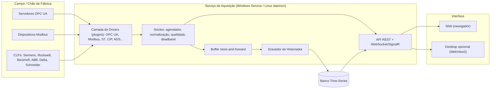

# DMapFactory — Documento de Estruturação do Projeto

> **Versão:** 0.1 (rascunho para levantamento de requisitos)
> **Data:** 22/10/2026
> **Objetivo deste documento:** organizar a visão do produto, propor uma arquitetura, comparar tecnologias e — principalmente — listar **todas as perguntas** que precisam ser respondidas para que o software possa ser construído.
>
> ➡️ **Questionário respondido.** As decisões finais (linguagem C#/.NET 10, aplicação **Desktop WPF**) estão em [02-Especificacao-Requisitos-v1.md](02-Especificacao-Requisitos-v1.md).

---

## 1. Visão Geral

Software de **aquisição, historização e monitoramento de dados industriais**, que:

1. Conecta-se a **servidores e dispositivos OPC UA** (prioridade da fase 1).
2. **Armazena histórico** (time-series) das variáveis (tags) coletadas.
3. **Exibe os dados** em tempo real e históricos em **modo planilha (grid)** e **modo gráfico (tendência)**.
4. Futuramente, conecta-se via **Modbus (TCP/RTU)** e **protocolos nativos de CLPs** (Siemens, Rockwell, Beckhoff, ABB, Delta, Schneider, entre outros).

### 1.1 Escopo por fases (proposta)

| Fase | Entregas principais |
|---|---|
| **F1 – MVP OPC UA** | Cliente OPC UA (browse, subscription, leitura), cadastro de tags, historização, grid em tempo real, gráfico de tendência básico, exportação CSV/Excel |
| **F2 – Historiador robusto** | Deadband/compressão, store‑and‑forward, retenção/agregações, consultas históricas rápidas, relatórios |
| **F3 – Modbus** | Modbus TCP e RTU (serial), mapeamento de registradores, tipos de dados e byte order |
| **F4 – Drivers nativos** | Siemens S7, Rockwell (EtherNet/IP‑CIP), Beckhoff ADS, demais fabricantes |
| **F5 – Recursos avançados** | Alarmes/eventos, escrita em tags, integrações (MQTT, REST, SQL, ERP/MES), redundância |

---

## 2. Arquitetura Proposta

A recomendação é uma arquitetura **desacoplada em camadas**, onde a coleta de dados roda como **serviço** independente da interface do usuário. Isso permite que a coleta continue mesmo com a interface fechada — requisito praticamente obrigatório para um historiador.

### 2.1 Componentes

| Componente | Responsabilidade |
|---|---|
| **Drivers (plugins)** | Interface comum (`IDriver`: conectar, browse, ler, assinar, escrever). Cada protocolo é um plugin isolado — permite adicionar Modbus/S7/etc. sem alterar o núcleo. |
| **Núcleo de aquisição** | Agendamento de polling, gerência de subscriptions, conversão de tipos, escalonamento (scaling), qualidade (Good/Bad/Uncertain), timestamps (fonte x servidor). |
| **Buffer store‑and‑forward** | Garante que nenhum dado seja perdido se o banco ficar indisponível. |
| **Historiador** | Gravação em lote, deadband/compressão (ex.: swinging door), retenção, agregações (min/máx/média por intervalo). |
| **API** | REST para configuração e consultas; WebSocket/SignalR para tempo real. |
| **Interface** | Grid (planilha), gráficos de tendência, configuração de conexões/tags, usuários. |

### 2.2 Modelo de dados mínimo

- **Conexão** (protocolo, endereço, segurança, parâmetros)
- **Grupo de varredura** (taxa de amostragem, modo: subscription/polling)
- **Tag** (endereço/NodeId, tipo de dado, unidade, escala, deadband, historizar sim/não, descrição)
- **Amostra** (tag_id, timestamp, valor, qualidade)
- **Usuário / Perfil / Auditoria**

---

## 3. Avaliação das Linguagens de Programação

### 3.1 Critérios considerados

1. Qualidade e maturidade das **bibliotecas OPC UA**.
2. Disponibilidade de bibliotecas para **Modbus e CLPs** (fase futura).
3. **Desempenho** e estabilidade em execução 24/7.
4. Adequação para **serviço Windows** e/ou **Web**.
5. **Licenciamento** das bibliotecas (crítico se o software for comercializado).
6. Disponibilidade de mão de obra e produtividade.

### 3.2 Ecossistema de bibliotecas por linguagem

| Protocolo | C# / .NET | Python | Node.js / TypeScript | Java | Go | C/C++ / Rust |
|---|---|---|---|---|---|---|
| **OPC UA** | OPC Foundation UA‑.NETStandard (oficial, referência); Unified Automation e Softing (comerciais) | asyncua (opcua‑asyncio, LGPL) | node‑opcua (MIT, muito completo) | Eclipse Milo (EPL) | gopcua (MIT, mais limitado) | open62541 (C, MPL 2.0); Unified Automation C++ SDK; Rust: async‑opcua (em evolução) |
| **Modbus** | FluentModbus, NModbus | pymodbus (excelente) | modbus‑serial, jsmodbus | j2mod, digitalpetri modbus | goburrow/modbus, simonvetter/modbus | libmodbus (C); tokio‑modbus (Rust) |
| **Siemens S7** | S7NetPlus, Sharp7 | python‑snap7 | nodes7, node‑snap7 | Moka7, PLC4X | gos7 | Snap7 (C++) |
| **Rockwell (CIP/EtherNet/IP)** | libplctag.NET | pycomm3, pylogix | ethernet‑ip, st‑ethernet‑ip | PLC4X (parcial) | wrapper libplctag | libplctag (C) |
| **Beckhoff ADS** | **Beckhoff.TwinCAT.Ads (oficial)** | pyads | ads‑client | ads4j / PLC4X | wrappers comunitários | AdsLib (oficial, C++) |
| **Omron / Mitsubishi** | HslCommunication (comercial), libs comunitárias | pymcprotocol, fins | mcprotocol, omron‑fins | PLC4X | limitado | diversas |
| **ABB / Delta / Schneider** | Normalmente via **Modbus TCP** ou **OPC UA** (nativos desses CLPs) — mesmas libs acima | idem | idem | idem | idem | idem |

> [!NOTE]
> ABB (AC500), Delta (DVP/AS/AH) e Schneider (M221/M241/M251/M580) suportam majoritariamente **Modbus TCP/RTU** e, nos modelos mais novos, **OPC UA embarcado**. Portanto, ao implementar bem OPC UA + Modbus, grande parte desses fabricantes já fica coberta sem driver proprietário.

### 3.3 Pontos fortes e fracos

#### C# / .NET (10 LTS)
| Pontos fortes | Pontos fracos |
|---|---|
| SDK **oficial** da OPC Foundation (é a implementação de referência) | SDK oficial da OPC Foundation tem licença **dual GPL 2.0 / RCL** — para uso comercial fechado, exige ser membro da OPC Foundation ou usar SDK comercial |
| Driver **oficial Beckhoff ADS**; libs maduras para S7, CIP, Modbus | Interface desktop nativa (WPF/WinForms) fica presa ao Windows |
| Alto desempenho, multithreading e async nativos; ideal para serviço 24/7 | Curva de aprendizado maior que Python |
| Serviço Windows nativo (`Worker Service`) **e** roda em Linux/Docker | |
| ASP.NET Core + SignalR para Web em tempo real; Blazor permite UI em C# | |
| Padrão de mercado na automação industrial (Windows/SCADA) | |

#### Python
| Pontos fortes | Pontos fracos |
|---|---|
| Altíssima produtividade; ótimo para protótipos | Desempenho inferior; GIL limita paralelismo real (mitigável com asyncio/multiprocess) |
| Excelentes libs: asyncua, pymodbus, python‑snap7, pycomm3, pyads | Distribuição como executável Windows é frágil (PyInstaller, antivírus) |
| Ecossistema forte de análise de dados (pandas, numpy) | Tipagem dinâmica dificulta manutenção em projetos grandes |
| | asyncua é LGPL (aceitável, mas exige atenção) |
| | Menos indicado para milhares de tags em alta frequência |

#### Node.js / TypeScript
| Pontos fortes | Pontos fracos |
|---|---|
| node‑opcua é completo e MIT | Single‑thread: processamento pesado bloqueia o event loop |
| Mesma linguagem no backend e frontend | Libs de CLP menos maduras e com manutenção irregular |
| Excelente para Web e tempo real | Gerenciamento de memória em processos 24/7 exige cuidado |
| Pode virar desktop com Electron | Ecossistema npm volátil (dependências) |

#### Java
| Pontos fortes | Pontos fracos |
|---|---|
| Eclipse Milo é robusto; Apache PLC4X cobre muitos protocolos | Menos usado no nicho de automação em Windows |
| JVM estável para 24/7 | Consumo de memória maior; UI desktop datada |

#### Go
| Pontos fortes | Pontos fracos |
|---|---|
| Binário único, ótimo desempenho e concorrência | gopcua não cobre toda a especificação (segurança, métodos, eventos) |
| Ideal para gateways/edge | Libs de CLP escassas |

#### C/C++ e Rust
| Pontos fortes | Pontos fracos |
|---|---|
| Máximo desempenho, ideal para embarcados | Produtividade muito menor; maior risco de bugs |
| open62541 é excelente (C) | UI e Web exigiriam outra stack |
| Rust: segurança de memória | Ecossistema industrial em Rust ainda imaturo |

### 3.4 Matriz de pontuação (1 = fraco, 5 = excelente)

| Critério (peso) | C#/.NET | Python | Node/TS | Java | Go | C++/Rust |
|---|---|---|---|---|---|---|
| Bibliotecas OPC UA (5) | 5 | 4 | 5 | 4 | 2 | 4 |
| Bibliotecas de CLPs/Modbus (4) | 5 | 5 | 3 | 3 | 2 | 4 |
| Desempenho 24/7 (4) | 5 | 2 | 3 | 4 | 5 | 5 |
| Serviço Windows + Web (3) | 5 | 3 | 4 | 4 | 4 | 2 |
| Produtividade (3) | 4 | 5 | 4 | 3 | 4 | 2 |
| Mercado/mão de obra industrial (2) | 5 | 4 | 3 | 3 | 2 | 3 |
| **Total ponderado (máx. 105)** | **100** | **77** | **77** | **75** | **63** | **73** |

### 3.5 Recomendação de linguagem

> [!IMPORTANT]
> **Recomendação: C# com .NET 10 (LTS)** para o serviço de aquisição e API.
> É a única stack que combina SDK OPC UA de referência, driver oficial Beckhoff, bibliotecas maduras para Siemens/Rockwell/Modbus, alto desempenho e suporte tanto a Serviço Windows quanto a Web/Linux.
>
> **Alternativa:** Python é viável se o volume de tags for pequeno (< ~1.000 tags a 1 s) e a prioridade for prototipar rápido.

> [!NOTE]
> **Licenciamento do OPC UA em .NET (corrigido):** o SDK oficial (UA‑.NETStandard) é atualmente distribuído sob a **licença MIT** (OPC Foundation MIT License 1.00), sem a antiga restrição GPL/RCL. Pode ser usado em projetos abertos ou fechados.

---

## 4. Tipo de Aplicação: Web x Windows (Desktop)

### 4.1 Comparativo

| Critério | Web (servidor + navegador) | Desktop Windows (WPF/WinForms/WinUI) |
|---|---|---|
| Acesso multiusuário / remoto | ✅ Qualquer dispositivo com navegador | ❌ Instalação em cada máquina |
| Atualização / implantação | ✅ Atualiza só o servidor | ❌ Atualiza cada estação |
| Coleta contínua 24/7 | ✅ Serviço independente da UI | ⚠️ Só se separar em serviço |
| Funcionamento offline / máquina isolada | ⚠️ Requer servidor local (pode ser a mesma máquina) | ✅ Natural |
| Desempenho de gráficos com milhões de pontos | ⚠️ Bom com downsampling (LTTB) e libs como uPlot/ECharts | ✅ Excelente (SciChart, ScottPlot, LiveCharts) |
| Integração com hardware local (serial RS‑485) | ✅ No serviço backend | ✅ Direta |
| Segurança (rede OT, IEC 62443) | ⚠️ Exige HTTPS, autenticação, segmentação | ✅ Superfície de ataque menor |
| Dispositivos móveis / tablets | ✅ | ❌ |
| Independência de SO | ✅ Servidor em Windows, Linux ou Docker | ❌ Somente Windows |
| Custo de desenvolvimento | ⚠️ Duas stacks (backend + frontend) | ✅ Uma stack |
| Exportação para Excel | ✅ Download de arquivo | ✅ Direta |

### 4.2 Recomendação de tipo de aplicação

> [!TIP]
> **Recomendação: arquitetura híbrida "Serviço + Web"**
> - **Serviço de aquisição** (.NET Worker Service) rodando como **Serviço Windows** (ou daemon Linux/Docker).
> - **Interface Web** (ASP.NET Core + Blazor **ou** React/Angular) servida pelo próprio serviço.
> - **Opcional:** um "executável desktop" leve que apenas abre a interface Web em uma janela (WebView2/Tauri/Electron), para usuários que preferem a experiência de aplicativo Windows.
>
> Com isso, o mesmo produto atende **instalação monoposto offline** (tudo na mesma máquina) e **instalação servidor multiusuário**, sem reescrever a interface.

**Quando preferir Desktop puro:** usuário único, máquina sem rede, necessidade de gráficos com dezenas de milhões de pontos em tela e nenhuma exigência de acesso remoto.

### 4.3 Stack tecnológica sugerida (a confirmar após o questionário)

| Camada | Opção principal | Alternativas |
|---|---|---|
| Backend / Serviço | .NET 10 Worker Service + ASP.NET Core | — |
| OPC UA | OPC Foundation UA‑.NETStandard | Unified Automation / Softing / Traeger (comerciais) |
| Modbus | FluentModbus ou NModbus | — |
| Siemens / Rockwell / Beckhoff | S7NetPlus · libplctag.NET · Beckhoff.TwinCAT.Ads | HslCommunication (comercial, multi‑fabricante) |
| Tempo real | SignalR (WebSocket) | gRPC streaming |
| Banco histórico | **TimescaleDB** (PostgreSQL) | InfluxDB, QuestDB, SQL Server, SQLite (monoposto pequeno) |
| Banco de configuração | PostgreSQL / SQLite | SQL Server |
| Frontend | Blazor (C#) | React + TypeScript |
| Grid | AG Grid / MudBlazor DataGrid | Syncfusion, DevExpress, Telerik (comerciais) |
| Gráficos | uPlot / Apache ECharts | Plotly, SciChart (comercial) |
| Exportação | ClosedXML (Excel), CSV | EPPlus (comercial) |
| Instalador | WiX / MSIX / Docker | Inno Setup |

---

## 5. Requisitos Não Funcionais (propostos)

- **Disponibilidade:** coleta 24/7, reinício automático do serviço, reconexão automática com backoff.
- **Integridade:** store‑and‑forward; timestamps em UTC; qualidade do dado preservada.
- **Desempenho:** metas a definir (ver Q‑HIS‑01 a 05).
- **Segurança:** OPC UA com certificados (Sign & Encrypt), HTTPS, autenticação, perfis de acesso, trilha de auditoria.
- **Observabilidade:** logs estruturados, diagnóstico de conexões, métricas do serviço.
- **Manutenibilidade:** drivers como plugins, testes automatizados, simuladores para testes.

---

## 6. Questionário de Levantamento de Requisitos

> Responda diretamente abaixo de cada pergunta. Perguntas marcadas com ⭐ são **bloqueantes** para iniciar a fase 1.

### 6.1 Negócio e Escopo (NEG)

| ID | Pergunta | Resposta |
|---|---|---|
| ⭐ Q‑NEG‑01 | Qual o problema principal a resolver? (substituir um sistema existente? qual?) | uma aplicação nova para diagnose dos sinais das logicas presentes no PLC e rastrear ciclo da maquina e dados de processo |
| ⭐ Q‑NEG‑02 | O software será de uso interno, para clientes específicos ou um **produto comercial**? | para uso pessoal/ interno |
| Q‑NEG‑03 | Quantas plantas/instalações devem usar o sistema? | será uma aplicação stand-alone |
| ⭐ Q‑NEG‑04 | O código pode ser aberto (open source) ou precisa ser fechado/proprietário? (impacta licenças GPL/LGPL) | open source |
| Q‑NEG‑05 | Há orçamento para bibliotecas/componentes comerciais (SDK OPC UA, grids, gráficos)? Faixa de valor? | Não existe orçamento, o custo deve ser 0 |
| Q‑NEG‑06 | Qual o prazo desejado para o MVP e para a versão completa? | não tem prazo |
| Q‑NEG‑07 | Quem desenvolverá e manterá? Qual a experiência da equipe (C#, Python, JS…)? | Não tem equipe |
| Q‑NEG‑08 | Existem sistemas concorrentes de referência (ex.: Ignition, PI, Canary, Kepware, AVEVA Historian)? O que agrada/desagrada neles? | Não é concorrente com nenhuma aplicação conhecida |
| Q‑NEG‑09 | Haverá modelo de licenciamento do próprio software (por tags, por conexões, por usuário)? | não haverá licenciamento pago |

### 6.2 Usuários e Acesso (USR)

| ID | Pergunta | Resposta |
|---|---|---|
| ⭐ Q‑USR‑01 | Quantos usuários simultâneos são esperados? | podemos começar com 1 |
| Q‑USR‑02 | Quais perfis existem? (operador, engenheiro, gestor, administrador) e o que cada um pode fazer? | Somente 1 |
| Q‑USR‑03 | Autenticação: usuários locais, Active Directory/LDAP, SSO (Azure AD/Entra ID)? | Usuário local |
| Q‑USR‑04 | Haverá acesso remoto (fora da planta)? Via VPN? Internet? | Não |
| Q‑USR‑05 | Necessário acesso por tablet/celular? | Não |
| Q‑USR‑06 | Idiomas da interface (PT‑BR, EN, ES…)? | PT-BR, EN-USA, Espanhol |
| Q‑USR‑07 | Há exigência regulatória de **trilha de auditoria / assinatura eletrônica** (ex.: FDA 21 CFR Part 11, ANVISA, GAMP 5)? | Não |

### 6.3 Infraestrutura e Implantação (INF)

| ID | Pergunta | Resposta |
|---|---|---|
| ⭐ Q‑INF‑01 | Onde o software será instalado? (PC industrial, servidor na planta, VM, nuvem, edge/gateway) | PC Industrial ou notebook de programação |
| ⭐ Q‑INF‑02 | Sistema operacional dos servidores/estações? (Windows 10/11, Windows Server, Linux) — versões | Comumente em Windows |
| Q‑INF‑03 | A rede industrial (OT) tem acesso à rede corporativa (IT) ou à internet? Há firewall/DMZ? | Sim tem acessoa à Internet e pode haver firewall |
| Q‑INF‑04 | Instalação monoposto (tudo em uma máquina), cliente‑servidor, ou ambos? | Fazer essa versão do software como instalação monoposto |
| Q‑INF‑05 | Requisitos de hardware mínimo disponíveis (CPU, RAM, disco)? | N/A |
| Q‑INF‑06 | Docker/containers são permitidos no ambiente? | Sim |
| Q‑INF‑07 | Necessidade de **redundância** (servidor primário/secundário, failover)? | Não |
| Q‑INF‑08 | Política de backup existente? | Não |
| Q‑INF‑09 | Restrições de TI: antivírus, políticas de grupo, portas permitidas, uso de banco de dados específico? | Não |

### 6.4 Comunicação OPC UA — Fase 1 (OPC)

| ID | Pergunta | Resposta |
|---|---|---|
| ⭐ Q‑OPC‑01 | Quais servidores OPC UA serão acessados? (fabricante/produto/versão — ex.: KEPServerEX, Siemens S7‑1500 embarcado, TwinCAT, Prosys, Matrikon) | Todos possiveis |
| ⭐ Q‑OPC‑02 | Quantos servidores OPC UA simultâneos? | 1 ou mais |
| ⭐ Q‑OPC‑03 | Políticas de segurança exigidas: None, Basic256Sha256, Aes128/Aes256? Modo Sign / SignAndEncrypt? | todas possíveis através de configuração |
| Q‑OPC‑04 | Autenticação no servidor: anônima, usuário/senha, certificado X.509? | Depende da configuração escolhida |
| Q‑OPC‑05 | Como os certificados serão gerenciados? (auto‑assinados, CA corporativa, GDS) | auto-assinados, gerados na mesma aplicação |
| Q‑OPC‑06 | Será necessário **navegar (browse)** no espaço de endereços para selecionar tags, ou as tags serão importadas de lista (CSV/Excel)? | Sim será necessário navegar. Posteriormente podemos incluir o recurso de importar|
| Q‑OPC‑07 | Modo de aquisição: **subscription** (por mudança) ou **leitura cíclica (polling)**? Ou ambos? | Ambos |
| Q‑OPC‑08 | Tipos de dados envolvidos: numéricos, booleanos, strings, arrays, **estruturas/UDTs** (ExtensionObjects)? | Todos possiveis |
| Q‑OPC‑09 | Será necessário **escrever** valores nos servidores? (setpoints, comandos) — com confirmação? | Não, podemos colocar esse recurso futuramente |
| Q‑OPC‑10 | Precisa ler **Alarmes & Eventos (A&C)** do servidor? | Não, podemos colocar esse recurso futuramente |
| Q‑OPC‑11 | Precisa ler **histórico do servidor (Historical Access – HA)** para preencher lacunas? | Não, podemos colocar esse recurso futuramente, o objetivo é fazer a aquisição dos dados e historiar localmente ( pode ser arquivo TXT |
| Q‑OPC‑12 | Precisa chamar **Métodos** OPC UA? | Não |
| Q‑OPC‑13 | O software também deverá atuar como **servidor OPC UA** (expor os dados coletados para outros sistemas)? | Não |
| Q‑OPC‑14 | Há ainda equipamentos **OPC Classic (DA/HDA)**? (exigiria DCOM/Windows ou wrapper/gateway) | Não, mas podemos incluir esse recurso futuramente |
| Q‑OPC‑15 | Necessidade de OPC UA **PubSub** (MQTT/UDP)? | Não, mas podemos incluir esse recurso futuramente |

### 6.5 Historização (HIS)

| ID | Pergunta | Resposta |
|---|---|---|
| ⭐ Q‑HIS‑01 | Quantidade total de tags previstas — no início e em 3–5 anos? | Não previsto. Podemos começar com 1000 |
| ⭐ Q‑HIS‑02 | Taxa de amostragem: mais rápida e típica? (ex.: 100 ms, 1 s, 10 s) | Sim |
| ⭐ Q‑HIS‑03 | Por quanto tempo os dados devem ser mantidos (retenção)? Dados brutos x agregados? | Deve ser mantido enquanto estiver fazendo a requisição, quando alternar on-line para off-line, deve gerar novo arquivo |
| Q‑HIS‑04 | Deve gravar **somente por mudança** (com deadband absoluto/percentual) ou toda amostra? | Somente por mudança |
| Q‑HIS‑05 | Aceita compressão com perda (ex.: swinging door) ou exige dado bruto integral? | sem compressão |
| Q‑HIS‑06 | Há preferência/obrigação de banco de dados? (SQL Server, PostgreSQL, Oracle, InfluxDB…) | Pode ser armazenado em TXT CSV e SQL |
| Q‑HIS‑07 | Os dados precisam ser acessíveis por outras ferramentas (Power BI, Grafana, Excel, SQL direto)? | Não, mas podemos incluir esse recurso futuramente |
| Q‑HIS‑08 | Necessário **store‑and‑forward** (buffer local quando o banco/rede cair)? Por quanto tempo? | Sugestão: 30s |
| Q‑HIS‑09 | Precisão de timestamp: usar o timestamp da **fonte** (CLP/servidor) ou do **coletor**? Sincronização NTP disponível? | Sim, da fonte |
| Q‑HIS‑10 | Necessidade de agregações pré‑calculadas (média horária, totalizadores, OEE, contadores)? | Não, mas podemos incluir esse recurso futuramente |
| Q‑HIS‑11 | Dados de **batelada/lote** ou eventos de produção precisam ser associados às séries? | Sim, prever esse recurso |

### 6.6 Visualização — Planilha e Gráfico (VIS)

| ID | Pergunta | Resposta |
|---|---|---|
| ⭐ Q‑VIS‑01 | **Modo planilha:** deve mostrar tempo real (lista de tags com valor atual) e/ou histórico (tabela tempo × tags)? | Mostrar tempo real, e toda alteração de qualquer sinal deve incluir uma nova linha exibindo o dado atual de todas as tags |
| Q‑VIS‑02 | Na planilha: filtros, ordenação, agrupamento, colunas configuráveis, cores por limites? | Sim |
| Q‑VIS‑03 | Exportação: CSV, Excel (.xlsx), PDF? Com intervalo e agregação escolhidos pelo usuário? | Sim |
| ⭐ Q‑VIS‑04 | **Modo gráfico:** quantas penas (tags) simultâneas por gráfico? | Todas as tags possíveis sem sobrecarregar a aplicação |
| Q‑VIS‑05 | Recursos de gráfico: zoom/pan, cursor com valores, múltiplos eixos Y, comparação de períodos, gráfico XY, barras? | Sim |
| Q‑VIS‑06 | Maior janela de tempo exibida de uma vez (1 h, 1 dia, 1 ano)? | Sim |
| Q‑VIS‑07 | Os usuários poderão **salvar telas/visões** (conjuntos de tags e gráficos) e compartilhá‑las? | Sim |
| Q‑VIS‑08 | Necessidade de **dashboards** (indicadores, gauges) ou **telas sinópticas** (desenho do processo, estilo SCADA)? | Não, mas podemos incluir esse recurso futuramente |
| Q‑VIS‑09 | Relatórios agendados (diário/turno) enviados por e‑mail? | Sim |
| Q‑VIS‑10 | Existe identidade visual (cores, logotipo) a seguir? Tema claro/escuro? | Não existe identidade, vamos fazer um tema cinza e posteriormente trabalhamos nas questões das cores. Opte por baixo constraste, visual clean e leve |

### 6.7 Alarmes e Notificações (ALM)

| ID | Pergunta | Resposta |
|---|---|---|
| Q‑ALM‑01 | O software deve gerar alarmes próprios (limites HH/H/L/LL, desvio, taxa de variação)? | Não, mas podemos incluir esse recurso futuramente |
| Q‑ALM‑02 | Reconhecimento de alarmes por usuário, com histórico? | Não, mas podemos incluir esse recurso futuramente |
| Q‑ALM‑03 | Notificações: e‑mail, SMS, Teams/Telegram/WhatsApp, sonoro na tela? | Não, mas podemos incluir esse recurso futuramente |
| Q‑ALM‑04 | Alarme de **falha de comunicação** com dispositivos? | Sim, através de indicativo visual e logs |

### 6.8 Integrações (INT)

| ID | Pergunta | Resposta |
|---|---|---|
| Q‑INT‑01 | Publicar dados em **MQTT** (Sparkplug B?) ou plataformas de nuvem (Azure IoT, AWS IoT)? | Não, mas podemos incluir esse recurso futuramente |
| Q‑INT‑02 | Expor **API REST** para outros sistemas? | Não |
| Q‑INT‑03 | Integração com ERP/MES (SAP, TOTVS, outros)? | Não |
| Q‑INT‑04 | Importar/exportar configuração de tags via Excel/CSV? | Sim |

### 6.9 Protocolos Futuros — Modbus e CLPs (PLC)

| ID | Pergunta | Resposta |
|---|---|---|
| Q‑PLC‑01 | Modbus: TCP, RTU (RS‑485/RS‑232), ou ambos? Haverá conversores serial‑Ethernet? | Nesta primeira versão vamos fazer somente comunicação OPC UA |
| Q‑PLC‑02 | Modbus: quantos escravos/dispositivos? Mapas de registradores disponíveis? Tipos (float, int32, byte/word swap)? | Nesta primeira versão vamos fazer somente comunicação OPC UA |
| Q‑PLC‑03 | **Siemens:** modelos (S7‑200/300/400/1200/1500, LOGO!)? Acesso otimizado de blocos (S7‑1200/1500 exige configuração "PUT/GET" ou uso do OPC UA embarcado)? | Nesta primeira versão vamos fazer somente comunicação OPC UA |
| Q‑PLC‑04 | **Rockwell:** ControlLogix/CompactLogix (tags simbólicas) ou MicroLogix/SLC/PLC‑5 (PCCC)? | Nesta primeira versão vamos fazer somente comunicação OPC UA |
| Q‑PLC‑05 | **Beckhoff:** TwinCAT 2 ou 3? Haverá ADS Router/TwinCAT instalado no servidor? | Nesta primeira versão vamos fazer somente comunicação OPC UA |
| Q‑PLC‑06 | **ABB:** AC500, AC800M, robôs? Qual protocolo disponível (Modbus, OPC UA, MMS)? | Não. Nesta primeira versão vamos fazer somente comunicação OPC UA |
| Q‑PLC‑07 | **Delta:** séries (DVP, AS, AH)? Modbus TCP/RTU? | Nesta primeira versão vamos fazer somente comunicação OPC UA |
| Q‑PLC‑08 | **Schneider:** séries (M221, M241, M251, M340, M580, Premium)? Modbus TCP ou OPC UA? | Nenhum. Nesta primeira versão vamos fazer somente comunicação OPC UA |
| Q‑PLC‑09 | **Outros fabricantes:** Omron (FINS), Mitsubishi (MC Protocol/SLMP), WEG, Allen‑Bradley Micro800, Fanuc, inversores, medidores de energia? | Nenhum. Nesta primeira versão vamos fazer somente comunicação OPC UA |
| Q‑PLC‑10 | Aceita uso de **gateway comercial** (ex.: Kepware, Matrikon) como ponte em vez de drivers próprios? | Sim |
| Q‑PLC‑11 | Há disponibilidade de **equipamentos ou simuladores** para teste (PLCSIM Advanced, Emulate, TwinCAT runtime)? | Nenhum. Nesta primeira versão vamos fazer somente comunicação OPC UA |
| Q‑PLC‑12 | Quantidade estimada de CLPs por fabricante? | Nenhum. Nesta primeira versão vamos fazer somente comunicação OPC UA |

### 6.10 Segurança (SEG)

| ID | Pergunta | Resposta |
|---|---|---|
| Q‑SEG‑01 | Há política de cibersegurança OT a seguir (ISA/IEC 62443, NIST)? | Não |
| Q‑SEG‑02 | Exigência de HTTPS com certificado corporativo? | Não |
| Q‑SEG‑03 | Escrita em CLPs deve exigir confirmação dupla/senha? | Não |
| Q‑SEG‑04 | Logs de auditoria: quais ações registrar e por quanto tempo? | Vamos deixar essa questão para o futuro |

### 6.11 Qualidade e Suporte (QUA)

| ID | Pergunta | Resposta |
|---|---|---|
| Q‑QUA‑01 | Necessidade de documentação de validação (IQ/OQ/PQ)? | Sim |
| Q‑QUA‑02 | Quem dará suporte e como será a atualização do software em campo? | Não previsto |
| Q‑QUA‑03 | Critérios de aceite do MVP (ex.: "coletar 500 tags a 1 s por 30 dias sem perda")? | Coletar 50 tags a 100ms por 2 horas |

---

## 7. Roadmap Sugerido (após respostas)

| Etapa | Atividades-chave |
|---|---|
| 0 | Responder questionário, decidir licenciamento, banco de dados e stack de UI |
| 1 | Conectar a servidor OPC UA real/simulado com segurança, browse, subscription; medir desempenho |
| 2 | Cadastro de conexões e tags, gravação no banco, grid tempo real, tendência histórica, exportação |
| 3 | Store‑and‑forward, deadband, retenção, usuários/perfis, auditoria, instalador |
| 4–5 | Implementação de drivers como plugins sobre a mesma interface `IDriver` |
| 6 | Conforme prioridades levantadas |

---

## 8. Riscos Identificados

| Risco | Impacto | Mitigação |
|---|---|---|
| Licença GPL do SDK OPC UA em produto comercial | Alto | Definir Q‑NEG‑02/04 cedo; orçar SDK comercial ou associação à OPC Foundation |
| Bibliotecas comunitárias de CLP sem suporte | Médio | Priorizar OPC UA/Modbus; isolar drivers em plugins; considerar libs comerciais |
| Volume de dados subestimado | Alto | Definir Q‑HIS‑01/02/03; testes de carga desde a PoC |
| Acesso S7‑1200/1500 bloqueado (PUT/GET, proteção) | Médio | Preferir OPC UA embarcado nos CLPs modernos |
| Falta de equipamentos para teste | Médio | Simuladores (Prosys OPC UA Simulation Server, PLCSIM, ModbusPal/diagslave) |
| Segurança OT (exposição da interface Web) | Alto | HTTPS, autenticação, segmentação de rede, princípio do menor privilégio |
| Escopo crescente (virar um SCADA completo) | Alto | Fases bem definidas e critérios de aceite por fase |

---

## 9. Próximos Passos

1. Preencher o questionário da **seção 6** (prioridade para os itens ⭐).
2. Validar a recomendação de **linguagem (C#/.NET 10)** e **arquitetura (Serviço + Web)**.
3. Decidir sobre **licenciamento** do SDK OPC UA e banco de dados histórico.
4. Iniciar a **prova de conceito OPC UA** com um servidor real ou simulado.
