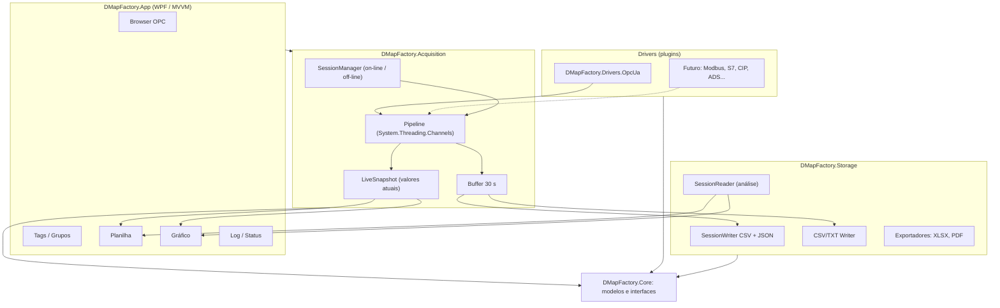
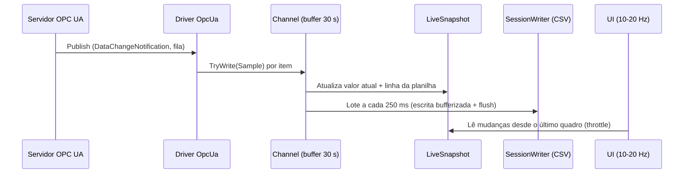

# DMapFactory — Especificação de Requisitos e Arquitetura (v1)

> **Versão:** 1.0 (baseada nas respostas da seção 6 do documento [01-Estruturacao-do-Projeto.md](01-Estruturacao-do-Projeto.md))
> **Data:** 22/10/2026
> **Linguagem definida:** C# / .NET 10 (LTS)

---

## 1. Resumo das Decisões

| Tema | Decisão | Origem |
|---|---|---|
| Propósito | Ferramenta de **diagnóstico de sinais da lógica do CLP**, **rastreio do ciclo de máquina** e **dados de processo** | Q‑NEG‑01 |
| Uso / distribuição | Uso pessoal/interno, **open source**, **custo zero** | Q‑NEG‑02/04/05/09 |
| Instalação | **Stand‑alone, monoposto**, PC industrial ou notebook de programação, Windows | Q‑NEG‑03, Q‑INF‑01/02/04 |
| Usuários | 1 usuário local, sem acesso remoto ou móvel | Q‑USR‑01..05 |
| Idiomas | PT‑BR, EN‑US, ES | Q‑USR‑06 |
| Protocolo v1 | **Somente OPC UA (cliente)** | Q‑PLC‑01..12 |
| Tipo de aplicação | **Desktop Windows (WPF)** — *revisado, ver seção 2* | Respostas acima |
| Armazenamento | **Um arquivo por sessão de aquisição** (cada passagem on‑line → off‑line gera um arquivo novo) | Q‑HIS‑03/06 |
| Gravação | **Somente por mudança**, sem compressão, com **timestamp da fonte** | Q‑HIS‑04/05/09 |
| Critério de aceite do MVP | **50 tags a 100 ms por 2 horas** sem perda | Q‑QUA‑03 |
| Licença do projeto | **MIT** (o SDK OPC UA da OPC Foundation agora é MIT — ver seção 9) | Q‑NEG‑04 |

---

## 2. Revisão: Web → Desktop

No documento 01, a recomendação foi **Serviço + Web**. Ela partia do princípio de que haveria vários usuários, acesso remoto e coleta 24/7 em servidor. As respostas mostram outro cenário:

| Fator | Resposta | Favorece |
|---|---|---|
| Usuários | 1, local | Desktop |
| Acesso remoto / móvel | Não | Desktop |
| Instalação | Notebook de programação / PC industrial, monoposto | Desktop |
| Coleta | Por sessão (on‑line/off‑line), não 24/7 | Desktop |
| Gráficos com muitas penas a 100 ms | Desempenho de renderização crítico | Desktop |
| Custo zero, desenvolvedor único | Uma única stack | Desktop |

> [!IMPORTANT]
> **Nova decisão: aplicação Desktop Windows em WPF (.NET 10), padrão MVVM.**
> O motor de aquisição fica em **bibliotecas separadas da interface**. Assim, no futuro ele pode ser hospedado num Serviço Windows ou ganhar uma interface Web sem ser reescrito.

**Por que WPF e não Avalonia/WinUI/Blazor Hybrid?**

| Opção | Prós | Contras |
|---|---|---|
| **WPF** ✅ | Muito maduro; DataGrid com virtualização; ScottPlot.WPF; tema Fluent nativo no .NET 9+; ferramentas excelentes | Somente Windows (aceitável: Q‑INF‑02) |
| Avalonia | Multiplataforma, MIT, sintaxe parecida com WPF | Ecossistema menor; DataGrid menos maduro |
| WinUI 3 | Visual moderno | Menos maduro, empacotamento mais complexo, DataGrid limitado |
| Blazor Hybrid | Reaproveita UI Web | Gráficos de alta taxa no WebView são menos eficientes |

---

## 3. Escopo da Versão 1

### 3.1 Dentro do escopo (v1)

- Cliente OPC UA com **todas as políticas de segurança** configuráveis e **certificado auto‑assinado gerado pela aplicação**.
- Autenticação no servidor: anônima, usuário/senha e certificado X.509.
- **Navegação (browse)** no espaço de endereços para selecionar tags.
- Aquisição por **subscription** e por **polling** (configurável por grupo).
- Suporte a **todos os tipos de dados** (escalares, strings, arrays, estruturas/ExtensionObjects).
- Conexão com **1 ou mais servidores** simultâneos.
- **Sessões de aquisição** (on‑line/off‑line), gravadas por mudança em arquivo por sessão.
- **Modo planilha** em tempo real (nova linha a cada mudança, com snapshot de todas as tags).
- **Modo gráfico** com muitas penas, zoom/pan, cursor, múltiplos eixos Y, comparação de períodos, XY e barras.
- Abrir sessões anteriores para análise off‑line.
- Exportação **CSV, TXT, Excel (.xlsx) e PDF**.
- Importação/exportação da configuração de tags (CSV/Excel).
- Salvar e compartilhar **visões** (arquivos de projeto).
- Indicação visual e log de **falha de comunicação**.
- Interface em 3 idiomas, tema cinza de baixo contraste.
- Estrutura de dados preparada para **lote/batelada e ciclos de máquina**.

### 3.2 Fora do escopo v1 (previsto para o futuro)

| Recurso | Ref. |
|---|---|
| Escrita em tags | Q‑OPC‑09 |
| Alarmes & Eventos OPC UA; alarmes próprios; notificações | Q‑OPC‑10, Q‑ALM‑01..03 |
| Leitura de histórico do servidor (HA) | Q‑OPC‑11 |
| OPC Classic (DA/HDA) e OPC UA PubSub | Q‑OPC‑14/15 |
| Importação de tags por lista no lugar do browse | Q‑OPC‑06 |
| Acesso por Power BI/Grafana, agregações | Q‑HIS‑07/10 |
| Dashboards e telas sinópticas | Q‑VIS‑08 |
| MQTT / nuvem | Q‑INT‑01 |
| Modbus e drivers nativos de CLP | Q‑PLC‑* |
| Auditoria | Q‑SEG‑04 |
| Relatórios agendados por e‑mail | Q‑VIS‑09 — planejado para a v1.x (seção 12) |

---

## 4. Requisitos Funcionais

Prioridade: **M** = MVP · **V1** = versão 1 completa · **F** = futuro (já previsto na arquitetura)

### 4.1 Conexões OPC UA (CON)

| ID | Requisito | Prior. |
|---|---|---|
| RF‑CON‑01 | Cadastrar N servidores OPC UA (nome, endpoint URL `opc.tcp://…`). | M |
| RF‑CON‑02 | **Descobrir endpoints** (GetEndpoints) e listar política/modo de segurança disponíveis. | M |
| RF‑CON‑03 | Políticas suportadas: None, Basic128Rsa15\*, Basic256\*, Basic256Sha256, Aes128_Sha256_RsaOaep, Aes256_Sha256_RsaPss; modos None / Sign / SignAndEncrypt. (\* obsoletas — exibir aviso) | M |
| RF‑CON‑04 | Autenticação: anônima, usuário/senha, certificado X.509. Senhas guardadas com **DPAPI** (criptografia do Windows por usuário). | M |
| RF‑CON‑05 | **Gerar certificado de aplicação auto‑assinado** no primeiro uso; permitir regenerar, exportar (.der/.pfx) e ver detalhes. | M |
| RF‑CON‑06 | Gerenciar certificados de servidores: **confiar / rejeitar** certificado desconhecido (diálogo na primeira conexão), listas Trusted/Rejected. | M |
| RF‑CON‑07 | Reconexão automática com backoff e recuperação da subscription (republish/transfer). | M |
| RF‑CON‑08 | Indicador de estado por conexão: Conectado / Conectando / Falha / Desabilitado, com motivo (StatusCode). | M |
| RF‑CON‑09 | Configurar timeouts (sessão, operação), keep‑alive e lifetime. | V1 |

### 4.2 Navegação e Tags (TAG)

| ID | Requisito | Prior. |
|---|---|---|
| RF‑TAG‑01 | **Browser em árvore** do espaço de endereços, com carregamento sob demanda (lazy) e busca por nome. | M |
| RF‑TAG‑02 | Exibir atributos do nó: NodeId, BrowseName, DataType, ValueRank/ArrayDimensions, AccessLevel, Description e valor atual. | M |
| RF‑TAG‑03 | Adicionar tags por arrastar‑soltar ou seleção múltipla (incluindo "adicionar todas as variáveis da pasta"). | M |
| RF‑TAG‑04 | Propriedades da tag: alias, descrição, unidade, grupo, modo (subscription/polling), intervalo, deadband (padrão 0 = qualquer mudança), cor/eixo no gráfico, historizar sim/não. | M |
| RF‑TAG‑05 | **Arrays e estruturas:** decodificar ExtensionObjects pelo dicionário/DataTypeDefinition do servidor e permitir **expandir em sub‑tags** (ex.: `Motor.Speed`, `Array[3]`). | V1 |
| RF‑TAG‑06 | Importar/exportar a configuração de tags em CSV e Excel. | V1 |
| RF‑TAG‑07 | Grupos de aquisição: cada grupo tem modo, intervalo de amostragem, intervalo de publicação e tamanho de fila. | M |

### 4.3 Aquisição (ACQ)

| ID | Requisito | Prior. |
|---|---|---|
| RF‑ACQ‑01 | **Subscription:** MonitoredItems com SamplingInterval configurável (≥ 0 ms), QueueSize > 1 e DiscardOldest = false, para **não perder transições rápidas** entre publicações. | M |
| RF‑ACQ‑02 | **Polling:** leitura cíclica (serviço Read em lote) no intervalo do grupo; registrar somente quando o valor mudar. | M |
| RF‑ACQ‑03 | Filtro de mudança: DataChangeFilter (Status/Value/Timestamp) com deadband absoluto ou percentual opcional. | M |
| RF‑ACQ‑04 | **Timestamp:** usar o SourceTimestamp; se ausente, usar o ServerTimestamp; se também ausente, usar o horário local (e marcar a origem). | M |
| RF‑ACQ‑05 | Preservar a **qualidade** (StatusCode) de cada amostra; mudança de qualidade também gera registro. | M |
| RF‑ACQ‑06 | Botão **On‑line / Off‑line**: ao entrar on‑line, abre uma **nova sessão** (novo arquivo); ao sair, fecha e finaliza o arquivo. | M |
| RF‑ACQ‑07 | Na entrada on‑line, gravar o **valor inicial** de todas as tags (snapshot de referência). | M |
| RF‑ACQ‑08 | **Buffer store‑and‑forward de 30 s** (configurável) entre a aquisição e a gravação; avisar se ocupar mais de 80% e registrar perda, se houver. | M |
| RF‑ACQ‑09 | Monitor de desempenho: eventos/s, ocupação do buffer, latência de gravação, atraso de publicação. | V1 |

### 4.4 Sessões e Armazenamento (STO)

| ID | Requisito | Prior. |
|---|---|---|
| RF‑STO‑01 | Cada sessão gera uma **pasta/par de arquivos**: `*.csv` (eventos de mudança, formato estreito) + `*.session.json` (metadados, conexões e definição das tags). | M |
| RF‑STO‑02 | Nome automático: `AAAA-MM-DD_HHMMSS_<projeto>.csv` / `.session.json` em uma pasta configurável. | M |
| RF‑STO‑03 | Opção de gravar também um **TXT/CSV em formato largo** (planilha) em paralelo, para abrir direto no Excel. | V1 |
| RF‑STO‑04 | **Proteção contra perda:** escrita em lotes com *flush* a cada 250 ms; arquivo legível mesmo após queda de energia (perda máxima = último lote). | M |
| RF‑STO‑05 | Abrir sessões anteriores (modo **off‑line/análise**) com planilha e gráfico, carregando o CSV em memória. | M |
| RF‑STO‑10 | **Futuro:** arquivo de sessão SQLite (`.dmsession`) para sessões muito longas e consultas avançadas, mantendo o CSV como exportação. | F |
| RF‑STO‑06 | **Marcadores** na sessão: anotações manuais com timestamp (ex.: "troca de ferramenta"). | V1 |
| RF‑STO‑07 | **Lote/batelada:** associar um identificador de lote à sessão ou a faixas de tempo, informado manualmente ou lido de uma tag. | F (estrutura no MVP) |
| RF‑STO‑08 | **Ciclo de máquina:** definir tags de gatilho de início/fim (borda de subida/descida) para segmentar a sessão em ciclos, com duração e estatísticas por ciclo. | V1 |
| RF‑STO‑09 | Sem compressão e sem descarte de dados dentro da sessão (retenção = enquanto o arquivo existir). | M |

### 4.5 Modo Planilha (GRD)

| ID | Requisito | Prior. |
|---|---|---|
| RF‑GRD‑01 | **Tabela de mudanças em formato "largo":** colunas = Timestamp + uma coluna por tag; **cada mudança de qualquer tag gera uma linha** com o valor atual de todas as tags. | M |
| RF‑GRD‑02 | Destacar a(s) célula(s) que **mudaram** naquela linha. | M |
| RF‑GRD‑03 | **Agrupar mudanças com o mesmo timestamp de origem em uma única linha** (configurável). | M |
| RF‑GRD‑04 | Auto‑rolagem "seguir o fim" com pausa ao rolar manualmente. | M |
| RF‑GRD‑05 | Painel de **valores atuais** (lista de tags × valor, qualidade, timestamp). | M |
| RF‑GRD‑06 | Filtros (por intervalo de tempo e por condição de tag), ordenação, colunas configuráveis (mostrar/ocultar/reordenar) e **cores por limites**. | V1 |
| RF‑GRD‑07 | Booleanos exibidos como 0/1 ou ícone, conforme configuração. | M |
| RF‑GRD‑09 | **Aparência configurável por tag:** cor de texto/fundo, formato numérico, cor quando a tag muda e cor da **linha inteira** quando uma condição da tag for verdadeira (ex.: `Ciclo_Inicio = 1`). | V1 |
| RF‑GRD‑10 | **Destaque de ciclo:** linhas pertencentes a cada ciclo de máquina com cor de fundo alternada (ciclo par/ímpar) e linha de início de ciclo realçada. | V1 |
| RF‑GRD‑08 | Exportação do intervalo selecionado: CSV, TXT, XLSX, PDF; formato largo (planilha) ou estreito (tag, timestamp, valor, qualidade). | M (CSV/XLSX) · V1 (PDF) |

### 4.6 Modo Gráfico (CHT)

| ID | Requisito | Prior. |
|---|---|---|
| RF‑CHT‑01 | Tendência em tempo real com janela deslizante configurável e modo de análise histórica (sessão aberta). | M |
| RF‑CHT‑02 | **Penas analógicas** (linha em degrau, pois o valor fica constante até a próxima mudança) e **faixas digitais estilo analisador lógico** para booleanos (uma faixa empilhada por sinal). | M |
| RF‑CHT‑03 | Zoom/pan (mouse e teclado), autoescala, cursor com leitura de todos os valores, **dois cursores com Δt** (medição de tempo entre eventos). | M |
| RF‑CHT‑04 | Múltiplos eixos Y e múltiplos painéis sincronizados no tempo. | V1 |
| RF‑CHT‑05 | Comparação de períodos/ciclos (sobrepor ciclo N com o ciclo M, alinhados pelo gatilho). | V1 |
| RF‑CHT‑06 | Gráfico XY (tag × tag) e gráfico de barras. | V1 |
| RF‑CHT‑07 | Número de penas limitado apenas pelo desempenho: meta de **≥ 50 penas a 100 ms com UI fluida (≥ 30 fps)**; downsampling (min/máx por pixel) para janelas longas. | M |
| RF‑CHT‑08 | Exportar imagem (PNG/SVG) e incluir no PDF. | V1 |

### 4.7 Visões e Projeto (PRJ)

| ID | Requisito | Prior. |
|---|---|---|
| RF‑PRJ‑01 | **Arquivo de projeto `.dmproj` (JSON)** com conexões, grupos, tags e visões (sem senhas em texto claro). | M |
| RF‑PRJ‑02 | Salvar/abrir visões (conjunto de tags, layout da planilha, configuração dos gráficos). | V1 |
| RF‑PRJ‑03 | **Compartilhar** = copiar o arquivo `.dmproj`/visão; importar visão de outro projeto. | V1 |
| RF‑PRJ‑04 | Lista de projetos recentes e reabrir o último ao iniciar. | M |

### 4.8 Diagnóstico e Logs (LOG)

| ID | Requisito | Prior. |
|---|---|---|
| RF‑LOG‑01 | Indicador visual de falha de comunicação na barra de status e por conexão/tag (qualidade Bad em destaque). | M |
| RF‑LOG‑02 | Log em arquivo com rotação diária (conexões, desconexões, erros, mudanças de estado on/off‑line). | M |
| RF‑LOG‑03 | Visualizador de log dentro da aplicação, com filtro por nível. | V1 |

### 4.9 Interface e Idiomas (UI)

| ID | Requisito | Prior. |
|---|---|---|
| RF‑UI‑01 | Idiomas PT‑BR, EN‑US e ES, com troca em tempo de execução (arquivos `.resx`). | M (estrutura) · V1 (traduções completas) |
| RF‑UI‑02 | Tema cinza de baixo contraste, visual limpo e leve (seção 8). | M |
| RF‑UI‑03 | Layout com painéis encaixáveis: Browser OPC, Tags, Planilha, Gráfico, Log. | V1 |
| RF‑UI‑04 | Usuário único: **sem tela de login**; identifica o usuário do Windows nos logs. | M |

### 4.10 Relatórios (REP)

| ID | Requisito | Prior. |
|---|---|---|
| RF‑REP‑01 | Relatório PDF da sessão (resumo, tags, gráficos, estatísticas por ciclo). | V1 |
| RF‑REP‑02 | **Envio por e‑mail** (SMTP configurável) ao final da sessão ou em horário agendado. | V1.x |

---

## 5. Requisitos Não Funcionais

| ID | Requisito |
|---|---|
| RNF‑01 | **Desempenho mínimo (aceite):** 50 tags a 100 ms durante 2 h, **sem perda de eventos**, com UI fluida. |
| RNF‑02 | **Meta de capacidade:** 1.000 tags a 1 s, ou volume equivalente a cerca de 1.000 eventos/s. |
| RNF‑03 | A UI nunca bloqueia: aquisição e gravação rodam em threads separadas; atualização da tela limitada a 10–20 Hz. |
| RNF‑04 | Consumo de memória estável em sessões longas (sem crescimento contínuo). |
| RNF‑05 | Abrir uma sessão de 2 h (cerca de 3,6 milhões de eventos) em menos de 5 s e navegar no gráfico/planilha sem travar (virtualização). |
| RNF‑06 | Compatível com Windows 10 (22H2) e Windows 11, x64. |
| RNF‑07 | Distribuição **self‑contained** (sem exigir .NET instalado), portátil (ZIP) e/ou instalador. |
| RNF‑08 | Todas as dependências **gratuitas e open source**, com licenças compatíveis com MIT. |
| RNF‑09 | Cobertura de testes automatizados no núcleo (aquisição, armazenamento, montagem da planilha). |
| RNF‑10 | Documentação de validação **IQ/OQ/PQ** (seção 11). |

---

## 6. Arquitetura da Solução

### 6.1 Visão em camadas



### 6.2 Estrutura da solução (.NET 10)

```
DMapFactory/
├─ DMapFactory.sln
├─ src/
│  ├─ DMapFactory.Core/              # Modelos (Tag, Sample, Session...), interfaces (IDriver, ISampleSink), sem dependências externas
│  ├─ DMapFactory.Drivers.OpcUa/     # Implementação IDriver com o SDK da OPC Foundation
│  ├─ DMapFactory.Acquisition/       # SessionManager, pipeline, buffer, LiveSnapshot, detecção de ciclos
│  ├─ DMapFactory.Storage/           # Sessão CSV + JSON, exportadores XLSX/PDF, leitor de sessão (SQLite no futuro)
│  ├─ DMapFactory.Localization/      # Recursos .resx (pt-BR, en-US, es)
│  └─ DMapFactory.App/               # WPF, MVVM, temas, views
├─ tests/
│  ├─ DMapFactory.Core.Tests/
│  ├─ DMapFactory.Acquisition.Tests/
│  ├─ DMapFactory.Storage.Tests/
│  └─ DMapFactory.IntegrationTests/  # Contra o servidor de teste
├─ tools/
│  └─ DMapFactory.TestServer/        # Servidor OPC UA de teste (simula N tags a X ms) — base do teste de aceite
└─ docs/
```

### 6.3 Interface de driver (contrato para os protocolos futuros)

```csharp
public interface IDriver : IAsyncDisposable
{
    string Protocol { get; }                                   // "OPCUA", "MODBUS", "S7"...
    ConnectionState State { get; }
    event EventHandler<ConnectionStateChangedEventArgs> StateChanged;

    Task ConnectAsync(CancellationToken ct);
    Task DisconnectAsync(CancellationToken ct);

    IAsyncEnumerable<BrowseNode> BrowseAsync(string? parentId, CancellationToken ct);
    Task<IReadOnlyList<Sample>> ReadAsync(IReadOnlyList<TagAddress> tags, CancellationToken ct);

    // Inicia a aquisição de um grupo (subscription ou polling) e publica as amostras no sink
    Task StartGroupAsync(AcquisitionGroup group, ISampleSink sink, CancellationToken ct);
    Task StopGroupAsync(Guid groupId, CancellationToken ct);
}

public readonly record struct Sample(
    int TagId, DateTime SourceTimestampUtc, DateTime ReceivedUtc,
    TimestampOrigin Origin, VariantValue Value, uint StatusCode);
```

### 6.4 Pipeline de dados



- **Channel limitado** com capacidade de 30 s na taxa máxima configurada (ex.: 50 tags × 10 Hz × 30 s = 15.000 amostras; mínimo de 50.000).
- **Gravação em lote** com `StreamWriter` bufferizado e *flush* periódico, suportando centenas de milhares de linhas/s.
- A UI **nunca** é notificada amostra a amostra: um temporizador de despacho consome o que acumulou desde o último quadro.

---

## 7. Modelo de Dados

### 7.1 Arquivos de sessão (formato principal — CSV + JSON)

**`2026-10-22_140000_Linha1.csv`** — eventos de mudança, formato estreito, UTF‑8, separador `;`:

```
Seq;TimestampUtc;TagId;Value;Quality;TsOrigin
1;2026-10-22T17:00:00.1000000Z;1;1;Good;S
2;2026-10-22T17:00:00.1000000Z;2;1450.2;Good;S
3;2026-10-22T17:00:00.2000000Z;2;1452.8;Good;S
```

- `Seq`: ordem de chegada (desempata timestamps iguais).
- `TsOrigin`: `S` = Source, `V` = Server, `L` = Local.
- Arrays e estruturas: valor serializado em JSON entre aspas.

**`2026-10-22_140000_Linha1.session.json`** — metadados (gravado ao abrir e atualizado ao fechar a sessão):

```json
{
  "formatVersion": 1,
  "sessionId": "c1f0…",
  "project": "Linha1",
  "startedUtc": "2026-10-22T17:00:00Z",
  "endedUtc": "2026-10-22T19:00:00Z",
  "appVersion": "0.1.0", "machine": "NB-ENG01", "windowsUser": "io",
  "connections": [ { "id": 1, "name": "PLC1", "endpoint": "opc.tcp://192.168.0.10:4840", "security": "Basic256Sha256/SignAndEncrypt" } ],
  "tags": [ { "id": 1, "connectionId": 1, "address": "ns=3;s=\"DB1\".\"Motor_Run\"", "alias": "Motor_Run", "dataType": "Boolean", "unit": "" } ],
  "markers": [], "cycles": [], "batches": []
}
```

> [!NOTE]
> **Por que o CSV principal é "estreito" se a planilha é "larga"?**
> Com 50 tags a 100 ms são até cerca de 500 mudanças/s, ou aproximadamente **3,6 milhões de mudanças em 2 h**. No formato largo, cada linha repetiria as 50 colunas (cerca de **1,4 GB**, e o Excel abre no máximo 1.048.576 linhas). No formato estreito o arquivo fica com cerca de **180 MB**. A planilha larga é **montada na tela sob demanda** (virtualização), e a exportação/gravação em formato largo continua disponível (RF‑STO‑03, RF‑GRD‑08).

**Futuro (RF‑STO‑10):** arquivo SQLite `.dmsession` com as mesmas entidades (session, connection, tag, sample, marker, batch, cycle) para sessões muito longas.

```sql
CREATE TABLE session (            -- 1 linha
  id TEXT PRIMARY KEY, project_name TEXT, started_utc TEXT, ended_utc TEXT,
  app_version TEXT, machine_name TEXT, windows_user TEXT, notes TEXT
);
CREATE TABLE connection (id INTEGER PRIMARY KEY, name TEXT, endpoint TEXT, security TEXT);
CREATE TABLE tag (
  id INTEGER PRIMARY KEY, connection_id INTEGER, address TEXT,   -- NodeId
  alias TEXT, data_type TEXT, unit TEXT, group_name TEXT, mode TEXT, interval_ms INTEGER
);
CREATE TABLE sample (             -- formato "estreito": 1 linha por mudança
  seq INTEGER PRIMARY KEY,        -- ordem de chegada (desempate de timestamps iguais)
  tag_id INTEGER NOT NULL,
  ts INTEGER NOT NULL,            -- SourceTimestamp UTC em ticks (100 ns)
  ts_origin INTEGER,              -- 0=Source 1=Server 2=Local
  value_num REAL, value_text TEXT, value_blob BLOB,   -- numérico / string / array ou estrutura (JSON/binário)
  status INTEGER NOT NULL
);
CREATE INDEX ix_sample_ts ON sample(ts);
CREATE INDEX ix_sample_tag_ts ON sample(tag_id, ts);

CREATE TABLE marker (id INTEGER PRIMARY KEY, ts INTEGER, text TEXT, kind TEXT);       -- anotações
CREATE TABLE batch  (id INTEGER PRIMARY KEY, code TEXT, start_ts INTEGER, end_ts INTEGER, source TEXT); -- lote (futuro)
CREATE TABLE cycle  (id INTEGER PRIMARY KEY, number INTEGER, start_ts INTEGER, end_ts INTEGER, duration_ms REAL);
```

### 7.2 Formatos de exportação CSV/TXT

**Largo (planilha):**
```
Timestamp;Motor_Run;Speed;Pressure;Changed
2026-10-22 14:00:00.100;1;1450.2;3.21;Speed
2026-10-22 14:00:00.200;1;1452.8;3.21;Speed
```
**Estreito:**
```
Timestamp;Tag;Value;Quality
2026-10-22 14:00:00.100;Speed;1450.2;Good
```
Separador, formato de data/hora, separador decimal e fuso horário (UTC ou local) configuráveis.

### 7.3 Arquivo de projeto `.dmproj` (JSON)

Contém conexões (sem segredos em texto claro), grupos, tags, visões (planilha e gráficos), pasta das sessões, opções de exportação e idioma.

---

## 8. Interface do Usuário

### 8.1 Telas principais

| Tela | Conteúdo |
|---|---|
| **Principal** | Barra de ferramentas (Projeto, On‑line/Off‑line, Marcador, Exportar), painel esquerdo (Conexões + Browser OPC), centro em abas (Planilha / Gráfico / Valores atuais), barra de status (estado das conexões, eventos/s, buffer, duração da sessão) |
| **Conexão** | Endpoint, descoberta de endpoints, segurança, autenticação, teste de conexão |
| **Certificados** | Certificado da aplicação; listas Trusted/Rejected |
| **Tags / Grupos** | Grade editável das tags e grupos de aquisição |
| **Sessões** | Lista de sessões gravadas com duração, tamanho e nº de eventos; abrir para análise |
| **Exportação** | Intervalo, tags, formato, layout |
| **Configurações** | Idioma, pastas, formatos, buffer, logs |

### 8.2 Tema cinza de baixo contraste (proposta inicial)

| Token | Cor | Uso |
|---|---|---|
| `Background` | `#E9EAEC` | Fundo da janela |
| `Surface` | `#F3F4F5` | Painéis, cartões, grade |
| `SurfaceAlt` | `#ECEDEF` | Linhas alternadas da planilha |
| `Border` | `#D3D6DA` | Bordas e divisores (finos, 1 px) |
| `TextPrimary` | `#3C4046` | Texto principal |
| `TextSecondary` | `#727780` | Rótulos, cabeçalhos |
| `Accent` | `#6E8398` | Seleção, botões primários (azul‑acinzentado discreto) |
| `Changed` | `#E3E8EE` | Destaque da célula alterada |
| `Good` / `Uncertain` / `Bad` | `#7A9E7E` / `#C4A866` / `#B87A7E` | Qualidade e estado de comunicação (tons dessaturados) |

Diretrizes: fonte **Segoe UI Variable** de 12–13 px, espaçamento generoso, ícones de linha (Fluent System Icons, MIT), sem sombras fortes, cantos levemente arredondados (4 px). Todas as cores ficam em um `ResourceDictionary`, o que facilita o ajuste posterior e a criação de um tema escuro.

---

## 9. Stack Tecnológica (custo zero)

| Finalidade | Biblioteca | Licença |
|---|---|---|
| Runtime / UI | .NET 10, WPF | MIT |
| **OPC UA** | **OPCFoundation.NetStandard.Opc.Ua.Client** (UA‑.NETStandard) | **MIT** ✅ |
| MVVM | CommunityToolkit.Mvvm | MIT |
| Injeção de dependência / Host | Microsoft.Extensions.Hosting / DependencyInjection | MIT |
| Gráficos | **ScottPlot 5** (ScottPlot.WPF) — alto desempenho, milhões de pontos | MIT |
| Planilha | WPF DataGrid nativo + virtualização de dados própria | MIT |
| Tema / controles | Tema Fluent nativo do WPF (.NET 9+) com dicionário de cores próprio; opcional WPF‑UI | MIT |
| Sessão (v1) | CSV + System.Text.Json (nativos do .NET) | MIT |
| Banco da sessão (futuro) | Microsoft.Data.Sqlite | MIT |
| Excel | ClosedXML | MIT |
| PDF | PDFsharp + MigraDoc | MIT |
| E‑mail (v1.x) | MailKit | MIT |
| Logs | Serilog (+ Sinks.File) | Apache‑2.0 |
| Ícones | Fluent System Icons | MIT |
| Testes | xUnit, FluentAssertions\*, NSubstitute | Apache‑2.0 / BSD |
| Instalador | Publicação self‑contained + ZIP; opcional WiX Toolset ou Inno Setup | MS‑RL / livre |

> [!NOTE]
> **Correção em relação ao documento 01:** a licença do SDK oficial OPC UA .NET (UA‑.NETStandard) **foi alterada para MIT** (confirmado no `LICENSE.txt` do repositório). Não existe mais a restrição GPL/RCL. O projeto pode ser publicado sob **MIT**.
>
> \* A partir da v8, o FluentAssertions passou a ter licença comercial. Usar a **v7.x (Apache‑2.0)** ou a alternativa **Shouldly (BSD)**.

---

## 10. Estimativa de Desempenho (cenário de aceite)

| Métrica | Valor |
|---|---|
| Tags | 50 |
| Amostragem | 100 ms (10 Hz) |
| Pior caso (todas mudam sempre) | 500 eventos/s |
| Eventos em 2 h | cerca de 3,6 milhões |
| Tamanho do CSV da sessão (formato estreito, ~50 bytes/linha) | cerca de 180 MB |
| Capacidade de escrita CSV bufferizada | > 200.000 linhas/s → folga superior a 400× |
| RAM para abrir a sessão em análise (~32 bytes/evento) | cerca de 120 MB |
| Buffer de 30 s | 15.000 amostras (≈ 1–2 MB de RAM) |

> [!WARNING]
> **Limite físico do diagnóstico de sinais:** pulsos do CLP mais curtos que o **SamplingInterval efetivo do servidor** não são capturados. Para lógica rápida, configure SamplingInterval de 0 a 50 ms (se o servidor suportar) e QueueSize adequado. Mesmo assim, servidores OPC UA embarcados em CLPs costumam ter taxa mínima de 50–100 ms. Para sinais abaixo disso, a solução exigirá drivers nativos no futuro.

---

## 11. Estratégia de Testes e Validação

### 11.1 Testes

| Nível | Ferramenta / ambiente |
|---|---|
| Unitários | xUnit — montagem da planilha larga, filtro de mudança, timestamps, ciclos |
| Integração | **DMapFactory.TestServer** (servidor OPC UA próprio, feito com o mesmo SDK: N tags configuráveis, padrões senoidais/rampas/pulsos booleanos com sequência verificável) |
| Simuladores externos gratuitos | Prosys OPC UA Simulation Server; OPC Foundation Reference Server |
| Aceite / carga | Roteiro automático de 50 tags a 100 ms por 2 h, verificando continuidade (nenhuma sequência faltando) |

### 11.2 Documentação de validação (Q‑QUA‑01)

| Documento | Conteúdo |
|---|---|
| **IQ** – Qualificação de Instalação | Requisitos do PC, procedimento de instalação, verificação de versão/hash dos binários, geração do certificado |
| **OQ** – Qualificação de Operação | Casos de teste por requisito (RF‑xx) com resultado esperado e evidência: conexão em cada política de segurança, browse, subscription/polling, sessão, exportação |
| **PQ** – Qualificação de Desempenho | Teste de aceite de 50 tags × 100 ms × 2 h em ambiente real, com métricas de perda, latência e uso de recursos |
| **Matriz de rastreabilidade** | Requisito ↔ caso de teste ↔ evidência |

---

## 12. Roadmap Revisado


| Marco | Entregas | Critério de conclusão |
|---|---|---|
| **M0 Fundação** | Solução, projetos, DI, logs, tema cinza, idiomas (estrutura), TestServer básico | App abre com tema e troca de idioma |
| **M1 Conexão e Browse** | RF‑CON‑01..08, RF‑TAG‑01..04, certificados | Conecta ao TestServer e ao Prosys em None e Basic256Sha256/SignAndEncrypt; navega e adiciona tags |
| **M2 Aquisição e Sessão** | RF‑ACQ‑01..08, RF‑STO‑01/02/04/05/09, `.dmproj` | Grava sessão on/off‑line com subscription e polling |
| **M3 Planilha** | RF‑GRD‑01..05/07/08 (CSV/XLSX) | Planilha larga em tempo real e em sessão aberta |
| **M4 Gráfico** | RF‑CHT‑01..03/07 | Penas analógicas e digitais, cursores Δt, 50 penas fluidas |
| **M5 Aceite MVP** | Teste de 50 tags × 100 ms × 2 h, IQ/OQ/PQ do MVP | Zero perda, UI fluida, relatório de teste |
| **V1** | Estruturas/arrays, import/export de tags, filtros e cores, múltiplos eixos, XY/barras, comparação de ciclos, visões, marcadores, ciclos de máquina, PDF, CSV em streaming, traduções completas | OQ completo |
| **V1.x** | Relatórios agendados por e‑mail | — |

---

## 13. Riscos Atualizados

| Risco | Impacto | Mitigação |
|---|---|---|
| Servidor OPC UA embarcado limita taxa mínima ou nº de MonitoredItems | Alto | Ler limites do servidor (ServerCapabilities/OperationLimits) e avisar o usuário; dividir em várias subscriptions |
| Decodificação de estruturas/UDTs varia entre fabricantes | Médio | Usar o ComplexTypeSystem do SDK; testar com Siemens/Beckhoff/Kepware |
| Desenvolvedor único, sem prazo | Médio | Marcos pequenos e entregáveis; MVP enxuto |
| Volume da planilha larga em sessões longas | Médio | Armazenamento estreito + virtualização + snapshots |
| Relógio do CLP/servidor dessincronizado | Médio | Exibir a origem do timestamp; opção de usar o ServerTimestamp ou o horário local |
| Firewall bloqueando a porta 4840 ou outra | Baixo | Mensagens de erro claras no teste de conexão |
| Certificados recusados pelo servidor (CLP precisa confiar no cliente) | Médio | Assistente explicando como exportar o certificado do cliente e confiar nele no servidor |

---

## 14. Pendências e Premissas Assumidas

✅ **Revisado pelo usuário em 22/10/2026** (P5 e P7 ajustados e refletidos nas seções 4.4, 4.5 e 7).

| # | Pergunta original | Premissa assumida |
|---|---|---|
| P1 | Q‑HIS‑02 (taxa de amostragem) — resposta "Sim" | Configurável por grupo, de **0 ms (mais rápida que o servidor permitir) até 60 s**; padrão 100 ms |
| P2 | Q‑VIS‑06 (maior janela de tempo) — resposta "Sim" | Qualquer janela, até a **sessão inteira**, com downsampling |
| P3 | Q‑VIS‑01 (linha por mudança) | Mudanças com o **mesmo timestamp de origem** são agrupadas em uma única linha (configurável para "1 linha por mudança individual") |
| P4 | Q‑USR‑03 (usuário local) | **Sem tela de login**; o usuário do Windows é registrado nos logs |
| P5 | Q‑HIS‑06 (TXT, CSV e SQL) | CSV/TXT principal e por exportação; Arquivo SQLite por sessão para modo mais avançado que pode ser implementado em versão futura e, opcionalmente, gravação simultânea |
| P6 | Q‑HIS‑11 (lote) | O código de lote pode ser **manual ou lido de uma tag**; implementação completa no futuro |
| P7 | Q‑NEG‑01 (ciclo de máquina) | Ciclo definido por **tags de gatilho** (início/fim por borda); confirmar se existe esse sinal nos CLPs; deve ter cor diferente na linha toda no modo planilha ou ser configuravel a aparencia dos dados para cada tag |
| P8 | Q‑VIS‑09 (relatório por e‑mail) | Envio **ao final da sessão** ou agendado, via SMTP configurado pelo usuário; prioridade V1.x |
| P9 | Q‑INF‑02 (Windows) | Somente Windows 10/11 x64 — **WPF**. Se precisar de Linux no futuro, avaliar Avalonia |
| P10 | Q‑HIS‑08 (store‑and‑forward 30 s) | Buffer em memória de 30 s entre aquisição e disco; quedas do servidor são cobertas pela fila de republish do OPC UA |
